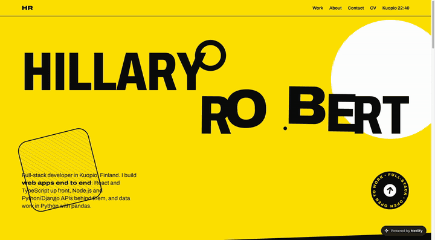

# Hillary Robert, portfolio

**Live site: [hillary-robert.netlify.app](https://hillary-robert.netlify.app)**



My personal portfolio: a one-page site with a loud, poster-style design and a lot of motion, built with plain HTML, CSS and JavaScript. It has no frameworks, no build step and no animation libraries.

I'm a full-stack developer in Kuopio, Finland, finishing a B.Sc. in IT at the University of Eastern Finland (April 2027). I work with React, TypeScript, Node.js, Python/Django and data processing in Python.

## Features

- **Rubber letters:** the giant name in the hero reacts to the cursor. Each letter has its own spring physics, gets wider and bolder as the cursor comes near (using the width and weight axes of a variable font), and wobbles back into place.
- **Ghost cursor:** when the mouse stops moving, an invisible cursor drifts across the hero so the letters keep moving. This also gives touch devices something to see.
- **Scramble intro:** the name shuffles through random characters on load before settling.
- **Custom cursor** that grows over links and buttons.
- **Scroll-reactive text bands:** the scrolling marquees speed up and skew with your scroll speed.
- **Project previews:** hovering a project floods the row with colour, stretches the title, and shows a preview card that follows the cursor and tilts as you move. The preview artwork is generated in SVG with code.
- **Highlighter effect:** words in the About section get highlighted one by one as you scroll.
- **Accessible motion:** every animation turns off when the visitor has *Reduce motion* switched on in their system settings. Links and buttons have visible keyboard focus.
- **Responsive:** the layout works from small phones up to wide screens. On touch devices, project thumbnails replace the hover previews.

## Built with

- HTML and CSS (custom properties, `clamp()`, CSS grid, variable fonts)
- Vanilla JavaScript (`requestAnimationFrame` loop, `IntersectionObserver`, spring physics)
- [Archivo](https://fonts.google.com/specimen/Archivo), a variable font from Google Fonts
- Hosted on [Netlify](https://www.netlify.com), which deploys automatically on every push to `main`

## Project structure

```
├── index.html             # Page content and structure
├── style.css              # Layout, colours and type
├── main.js                # All animation and interaction, in 10 commented blocks
└── Hillary_Robert_CV.pdf  # Downloadable CV
```

## Run it locally

No install needed.

```bash
git clone https://github.com/Hillary-Robert/portfolio.git
cd portfolio
```

Then open `index.html` in your browser, or use the **Live Server** extension in VS Code so the page reloads when you save.

## Contact

- Email: [roberthillary30@gmail.com](mailto:roberthillary30@gmail.com)
- LinkedIn: [linkedin.com/in/hillaryrobert30](https://www.linkedin.com/in/hillaryrobert30)
- GitHub: [github.com/Hillary-Robert](https://github.com/Hillary-Robert)
